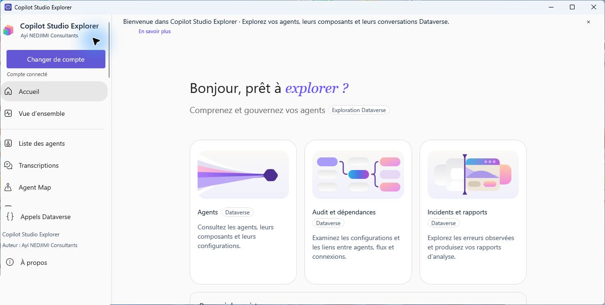

# Copilot Studio Explorer 3.1

[Français](README.md) | [English](README.en.md)

**Explore and govern Copilot Studio agents using Dataverse.**

By [Ayi NEDJIMI Consultants](https://ayinedjimi-consultants.fr).



Copilot Studio Explorer is a Windows desktop application for exploring agents, components, conversations, dependencies and configuration in a Dataverse environment. Version 3.1 adds a grouped agent explorer, a local chat, question generation, local review screens, configurable settings and an enhanced scenario workspace.

## Features

| Module | What it does |
| --- | --- |
| Agent registry and map | Search, filter and inspect agents; explore the loaded inventory on an interactive map. |
| Conversations and analytics | Browse conversation transcripts and inspect available activity data. |
| Security audit | Review 16 static checks with findings, evidence and recommendations. |
| Dependencies | Visualize observed relationships between agents, components, flows and connection references. |
| History and risk trends | Save local snapshots and compare available configuration and audit findings. |
| Incidents | Review errors found in sampled transcripts and accessible flow runs. |
| Governance and reports | Record local annotations and export HTML, CSV and PDF reports. |
| Solutions | Browse accessible solutions and their components. |
| Environments | Compare an agent with one in another environment in the same tenant, or compare exported snapshots. |
| Global search and custom rules | Search inspected configurations and evaluate locally defined rules. |
| Connection diagnostics and health | Check the current connection and summarize the agents already inspected. |
| Test scenarios | Record scenarios locally and optionally run a conversation through an agent's supplied channel endpoint. |

[View the screenshot gallery](captures-github/README.md). Screenshots were captured in a training environment; review visible agent and solution names, dates and statistics before publishing them.

## Requirements

- Windows 10 version 2004 or later, or Windows 11, on x64.
- A Dataverse environment, network access and a Microsoft account with appropriate permissions.
- WebView2 Runtime for the embedded maps and PDF export.
- For source builds: the .NET 8 SDK, Windows SDK and Windows App SDK build prerequisites. Node.js and npm are needed to rebuild the map.

## Download and quick start

1. Download the Windows x64 installer from the project releases and run it. Alternatively, extract the portable application archive and run `StudioDataverse.exe`; keep the complete folder together.
2. Use the Start menu shortcut, or the optional desktop shortcut, to open the installed application.
3. Select **Se connecter** and complete Microsoft sign-in.
4. Open the agent registry, choose an agent and inspect the information your account can access.

The application initially uses the training environment. Change the Dataverse URL, tenant and application identifiers in **Paramètres** and restart to connect elsewhere; the chosen registration and user must have the necessary permissions. The application interface is currently in French. Setup screens are available in French and English.

## Security and data scope

The newer audit, exploration and governance modules read Dataverse data. The existing agent rename action explicitly writes to Dataverse when invoked. Running a real test scenario sends a message through the supplied conversation channel and may trigger actions configured in that agent; use a test environment.

Audit results describe the configuration that was actually accessible. Effective permissions, external DLP policies, Entra consent and runtime protections are not established without their administrative sources and are reported as **not verifiable**. A sample without observed errors does not prove that no incident exists.

Snapshot data, annotations and governance records are stored locally under `%LOCALAPPDATA%/CopilotStudioExplorer/`, separated by organization and account. Governance records can be shared through manual export and import. Redaction of sensitive strings is heuristic; review exports before sharing. Advanced conversation analysis samples up to 50 records. Environment comparisons inspect referenced variable names and types, not their values.

## Build from source

From the repository root:

```powershell
dotnet publish outputs/StudioDataverse/StudioDataverse.csproj -c Release -p:Platform=x64 -o outputs/Application
dotnet run --project work/AgentQueryChecks/AgentQueryChecks.csproj
```

To rebuild and test the interactive maps:

```powershell
cd outputs/StudioDataverse/MapWeb
npm ci
npm run build
npm test
```

To build the installer after publishing the application to `outputs/Application`, compile `installer/CopilotStudioExplorer.iss` with Inno Setup 6. The installer offers French and English setup screens; the application interface remains in French.

## Project structure

```text
outputs/StudioDataverse/       WinUI application and Dataverse client
outputs/StudioDataverse/MapWeb/ Interactive map source and tests
work/AgentQueryChecks/         .NET checks
captures-github/               Screenshot gallery
```

## Validation and limitations

The automated checks use simulated network transports. Screenshots show the earlier 3.0 interface connected to a training environment; they do not prove every feature has been tested end to end. The installation and removal of 3.1, the PDF export, the second-environment connection, the model downloader and live scenario channels require validation in the intended environment.

The DLP, Entra administration and external runtime log sources are not integrated. The first response collected by a scenario test may need contextual review. The selected environment and access rights determine the data available to each user.

## Author

**Ayi NEDJIMI Consultants** — [ayinedjimi-consultants.fr](https://ayinedjimi-consultants.fr)
