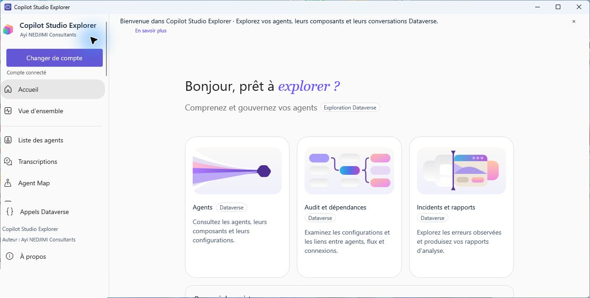

# Copilot Studio Explorer 3.1

[Français](README.md) | [English](README.en.md)

Auteur : **Ayi NEDJIMI Consultants**.

## Installation et prérequis

L’application fonctionne sur Windows 10 version 2004 ou ultérieure et Windows 11, en x64. Elle nécessite un accès réseau à Dataverse, un compte disposant des droits nécessaires et WebView2 Runtime pour les cartes et le PDF.

Télécharger l’installeur Windows x64 depuis les releases. Il propose un raccourci dans le menu Démarrer, un raccourci de bureau facultatif et la désinstallation. Il existe également une archive portable : l’extraire, puis lancer `StudioDataverse.exe` en conservant le dossier complet.

Les écrans de l’installeur sont disponibles en français et en anglais ; l’interface de l’application est actuellement en français. Les instructions de compilation de l’installeur se trouvent dans [installer/README.md](installer/README.md).
Même organisation Dataverse et connexion Microsoft que la version précédente. Aucun secret requis ou enregistré par les modules.

[Parcourir les captures d’écran](captures-github/README.md). Ces captures montrent la version 3.0 et proviennent de l’environnement de formation.

## Nouveautés de la version 3.1

- Explorateur d’agents avec groupes de publication, recherche, filtres et fiche à onglets ; navigation repliable et tableau de bord d’accueil.
- Chat et génération de questions sur le poste avec choix du modèle, ainsi que synthèses locales de l’agent et de ses constats de sécurité. Les propositions sont à vérifier.
- Téléchargement de fichiers GGUF publics depuis Hugging Face avec contrôle de taille et d’empreinte ; dépôt privé ou soumis à autorisation non pris en charge.
- Page Paramètres pour la connexion Dataverse, les collectes, la navigation et le moteur local. Les paramètres de connexion sont appliqués au prochain démarrage.
- Scénarios de test avec historique local et import de règles JSON dans l’audit.

Le modèle léger est inclus dans les distributions Windows ; les autres modèles peuvent être ajoutés depuis le chat. [Guide des paramètres](PARAMETRES.md) · [Guide de génération locale](GENERATION-LOCALE.md) · [État des modules](ETAT-MODULES.md).

## Modules principaux

### Audit de sécurité
Charger l’inventaire, choisir un agent ou le périmètre des agents analysés, puis lancer l’analyse.
16 contrôles statiques : authentification, déclenchement de l’authentification, politique d’accès, signatures de secrets, URL HTTP, actions sensibles et confirmations, web, déclencheurs, droits des connaissances, identités des connexions, DLP, autorisations Entra, protection en exécution, publication, propriétaire et destinations externes.
Criticité, preuve et recommandation sont affichées pour chaque contrôle. Les filtres portent sur l’agent, le texte, l’état et la criticité. L’affichage initial est borné à 150 contrôles, avec un bouton pour en afficher davantage ; les exports restent complets pour les résultats collectés.
Conforme signifie uniquement que le paramètre décrit a été observé dans les données lisibles. Les signatures sont heuristiques ; aucune configuration n’est certifiée sûre par cet audit.
Les droits effectifs, politiques DLP, consentements Entra et protections d’exécution ne sont pas inventés. Sans source d’administration connectée, ils sont Non vérifiables.

### Dépendances
Carte locale React Flow avec zoom, déplacement, recherche, filtre par type et sélection.
Liens agent → composant → flux → référence de connexion, ainsi que les sources et destinations URL déclarées. Un flux ou une référence inaccessible reste identifié comme non vérifiable.
La sélection affiche les agents potentiellement impactés à partir des chemins réellement extraits, y compris les ressources partagées lorsque plusieurs agents ont été analysés.
Ce sont des références de configuration, pas une preuve d’appels effectués en exécution. Aucune arête n’est inventée.

### Historique et versions
Le bouton « Relire et capturer un instantané » lit les données courantes et enregistre une version locale, avec libellé facultatif.
Choisir deux versions du même agent pour voir les ajouts, suppressions et modifications, avant/après. Les dates de création et de modification peuvent être ignorées.
Les sources non accessibles dans l’une des versions sont exclues de la comparaison pour éviter les fausses suppressions ; le statut de comparaison partielle est affiché.
Les valeurs sensibles détectées sont masquées avant stockage. Leur valeur réelle ne peut donc pas être comparée ni restaurée. Aucune restauration dans Dataverse n’est proposée.

### Centre d’incidents
Lecture explicite de transcriptions, avec période et taille configurables dans Paramètres, et des 20 derniers runs accessibles de chaque flux lié.
Les activités d’erreur explicites et les runs Failed sont regroupés, avec dates connues, résumé masqué, identifiants de corrélation et liens vers les transcriptions ou les dépendances.
Les avertissements précisent la portée des échantillons et les sources inaccessibles. Une absence d’erreur dans l’échantillon n’atteste pas l’absence d’incident.
Les listes volumineuses sont bornées à l’écran ; les rapports utilisent les occurrences collectées.

### Gouvernance
Inventaire des agents chargés, propriétaire lorsqu’il est lisible, compte désactivé ou propriétaire équipe à examiner, état de publication, type de solution, date de modification et dernière transcription accessible.
Les agents anciens ne sont jamais déclarés inutilisés à partir de leur date de modification. Une activité absente ou masquée par les droits reste inconnue.
Les références de connexion absentes ou sans identifiant sont à examiner ; la présence d’un identifiant ne prouve pas que la connexion fonctionne.
Étiquettes, commentaires et statuts de suivi par contrôle sont enregistrés localement et isolés par compte. Les statuts sont déclaratifs et ne modifient pas les observations d’audit.
L’affichage est progressif pour les grands inventaires.

### Rapports
Périmètre courant ou ensemble des agents analysés, avec audit, dépendances, incidents chargés, annotations et dernière comparaison de versions.
Exports HTML autonome, CSV protégé contre les formules et PDF via WebView2. Le rapport inclut l’auteur, les dates de collecte, les preuves, les recommandations et les limites de portée.
L’aperçu local est sans script ni chargement réseau externe. Le PDF nécessite WebView2 Runtime. Les fichiers ne sont écrits qu’aux emplacements choisis dans le sélecteur d’export.

## Données et droits
Toutes les lectures des nouveaux modules utilisent GET. Elles n’activent aucun agent, ne publient aucun flux et ne corrigent aucune configuration.
L’ancienne fonction explicite de renommage de la fiche agent reste disponible dans le registre ; elle n’est jamais appelée automatiquement par les nouveaux modules.
Les lectures nécessitent les autorisations appropriées sur bot, botcomponent, workflow, connectionreference, systemuser/team, flowrun et conversationtranscript. Les refus d’accès sont signalés sans masquer leur incidence sur les résultats.
Les captures et annotations sont stockées sous %LOCALAPPDATA%/CopilotStudioExplorer/, avec dossiers hachés par organisation et compte. L’aperçu du dernier rapport est lui aussi local au compte. Aucun jeton n’y est enregistré.
Les réponses sensibles des modules sont masquées dans le panneau API. La détection de secrets, e-mails et téléphones est heuristique et ne remplace pas une revue humaine.
Le chargement global peut prendre du temps : progression et bouton Annuler sont disponibles. Les résultats collectés avant une annulation restent consultables dans la session.

## Sources et compilation
- Sources : outputs/StudioDataverse/.
- Carte : outputs/StudioDataverse/MapWeb/.
- Tests .NET : work/AgentQueryChecks/.
- Build carte : npm.cmd run build depuis MapWeb.
- Tests carte : npm.cmd test depuis MapWeb.
- Tests .NET : dotnet run --project work/AgentQueryChecks/AgentQueryChecks.csproj.
- Publication : dotnet publish outputs/StudioDataverse/StudioDataverse.csproj -c Release -p:Platform=x64 -o outputs/Application.

## Validation et limites
129 vérifications .NET et 10 tests de cartes passent, soit 139 vérifications locales. Les transports réseau des tests sont simulés.
La compilation ne valide pas tous les droits du tenant ni le rendu PDF. Les captures ne constituent pas un test exhaustif des fonctionnalités.
Les intégrations aux consoles d’administration externes restent signalées Non vérifiables tant qu’elles ne sont pas connectées.

Références des règles :
- https://learn.microsoft.com/en-us/power-apps/developer/data-platform/webapi/reference/bot
- https://learn.microsoft.com/en-us/microsoft-copilot-studio/admin-data-loss-prevention
- https://learn.microsoft.com/en-us/microsoft-copilot-studio/security-and-governance

## Fonctions avancées

- Solutions : lecture des solutions et de leurs composants. Les liens avec les agents analysés signalent les références non retrouvées, sans conclure qu’une dépendance indirecte est manquante.
- Environnements : connexion indépendante à un environnement Dataverse du même tenant, choix explicite de l’agent cible et comparaison des composants, flux, références de connexion et métadonnées des variables référencées. Les valeurs des variables ne sont pas lues. L’import/export d’instantanés JSON reste disponible. Les sources inaccessibles sont exclues des comparaisons.
- Recherche globale : recherche des noms et configurations masquées des agents préalablement analysés.
- Conversations avancées : filtre par agent et période, recherche dans les messages et export texte avec masquage heuristique. L’échantillon est limité aux 50 premiers enregistrements ; les fragments sont présentés séparément.
- Règles personnalisées : nom, champ, opérateur et texte enregistrés localement ; aucune modification du score ou des contrôles standard.
- Évolution des risques : comparaison des constats des instantanés locaux et visualisation chronologique.
- Dossiers de gouvernance : responsable déclaré localement, criticité métier, date de revue et commentaire. Les dossiers peuvent être exportés et importés pour un partage manuel ; les dossiers locaux existants sont préservés. Ils ne modifient pas les propriétaires Dataverse.
- Diagnostic de connexion : vérification WhoAmI et explications adaptées aux erreurs courantes.
- Santé : tableau des agents analysés, risques, états non vérifiables et incidents déjà chargés.
- Scénarios : jeux locaux avec réponse saisie ou test réel déclenché manuellement via le point d’accès du canal mobile. Sélectionner l’agent et l’URL de son canal, puis la région. La première réponse textuelle après l’envoi est conservée ; elle peut nécessiter une revue de contexte. Une conversation réelle peut déclencher des actions et utiliser des ressources : choisir un environnement de test. Le jeton de conversation reste en mémoire et n’est pas enregistré.

Les deux connexions réelles, le canal de conversation et les droits associés restent à valider en conditions réelles. Les sources d’administration DLP, Entra et journaux externes ne sont pas intégrées ; les contrôles correspondants restent non vérifiables.
